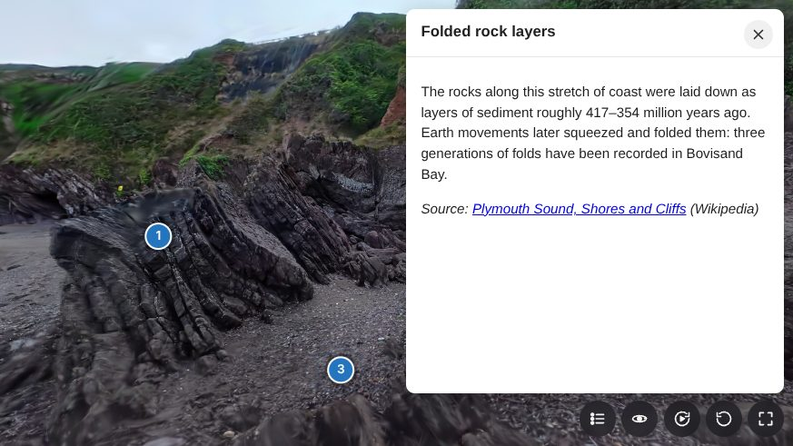

# H5P Gaussian Splat

Show **3D Gaussian splats** (`.sog` and `.ply`) in H5P, for Moodle, WordPress and other H5P
platforms. Learners can orbit around the scene or fly through it with W, A, S and D. Numbered
**hotspots** open text, images, video or audio.



## Download

**[⬇ Download gaussian-splat-libraries.h5p](https://github.com/blockie82/h5p-gaussian-splat/releases/latest/download/gaussian-splat-libraries.h5p)**
(latest version, about 1 MB). This is the only file you need to install it.

Want to see it working first? Download the example,
**[bovisands-gaussian-splat.h5p](https://github.com/blockie82/h5p-gaussian-splat/releases/latest/download/bovisands-gaussian-splat.h5p)**
(16 MB), and upload it to a content bank.

You don't need anything else in this repository to use the content type: the rest is
source code. All versions are on the [Releases page](https://github.com/blockie82/h5p-gaussian-splat/releases).

## Install in Moodle

1. Go to *Site administration → H5P → Manage H5P content types*.
2. Upload `gaussian-splat-libraries.h5p`.
3. Go to *Site administration → Development → Purge caches* (purge all caches).

**Gaussian Splat** now appears under *Add* in the content bank, with a cube icon. For
mod_hvp, WordPress, Lumi and other platforms, plus optional settings and troubleshooting,
see **[INSTALL.md](INSTALL.md)**.

## Creating content

1. In a content bank choose *Add → Gaussian Splat*.
2. Upload a splat file. `.sog` is recommended because it's 15–25× smaller than `.ply`.
3. Move to a good spot in the preview and click **Use this view as the starting view**.
4. Optional: click **Add hotspot**, click the scene where it should go, then add text, an image,
   video or audio. Using the keyboard instead? Aim the crosshair with the arrow keys and press Enter.
5. Fill in **Alternative text** (a short description of the scene for screen reader users).
6. Save.

Your site doesn't need to allow `.sog`/`.ply` uploads: if it doesn't, the editor stores the
file as `.txt` automatically.

## Features

**Learners**
- Drag to orbit. Right-drag or Shift-drag to pan. Pinch or scroll to zoom.
- The mouse wheel zooms only after the scene has been clicked (or with Ctrl held, or in full screen), so it doesn't take over page scrolling. A short hint appears if someone scrolls over the scene before clicking it.
- Two camera modes, like the SuperSplat viewer, switched with a toolbar button:
  - **Orbit**: drag rotates around the scene, right/Shift-drag pans, scroll/pinch zooms, arrow keys rotate.
  - **Fly**: drag looks around on the spot (drag right turns right), `W` `A` `S` `D` or the arrow keys move, `Q`/`E` move down/up, and scroll moves forwards/backwards. Movement eases in and out.
  - Pressing a movement key in orbit mode switches to fly. Hold **Shift** to move 4× faster; this also works if pressed mid-move. `Home` resets the view and mode.
  - Keys are matched by physical position, so AZERTY keyboards get ZQSD. Authors choose the *Starting camera mode* and can turn fly mode off.
- **On-screen navigation buttons** (turn, look up/down, zoom or move forwards/backwards): tap for a step, press and hold to keep going. They're shown on touch screens and can be switched on or off from the toolbar.
- Toolbar with auto-rotate, reset view and full screen buttons.
- A progress bar while the file downloads, plus an optional poster image.
- An optional "load on click" mode for large files.
- An xAPI `interacted` statement on first interaction.
- Screen reader label (from the alternative text) and instructions. All UI strings can be translated.
- Rendering pauses when the scene is off-screen or has stopped moving, to save battery.

**Authors (editor widget)**
- The file picker is limited to `.ply` and `.sog`. Other extensions are rejected before upload.
- After upload the file is checked. A PLY without splat properties (an ordinary point cloud or mesh) is removed, with an explanation.
- Live preview showing the format, splat count and file size.
- A warning for `.ply` files over 50 MB, with the command to convert them to `.sog`.
- **Use this view as the starting view**: saves the camera from the preview. It's stored as plain numbers (`x y z yaw pitch distance`), because H5P escapes quotes in text fields when content is saved. Views saved as JSON by 1.0.0/1.0.1 are still read.
- **Up direction** (−Y is the default for 3DGS/COLMAP captures; +Y, +Z and −Z are also available) and **Fine-tune orientation** (tilt and turn in degrees) for scenes that look tilted. The preview updates live, and a saved starting view turns with the scene instead of being lost.
- If the platform rejects the upload, a hint explains that the administrator must allow the extensions.

**Hotspots**
- Numbered markers fixed to points in the scene. Clicking one opens a popup with any mix of **Text, Image, Video and Audio**, up to six items per hotspot and fifty hotspots. These are H5P's own content types, so you get their usual editors and players.
- **Editor:** *Add hotspot* under the preview, then click the scene, or aim the crosshair with the keyboard and press Enter (*Place at crosshair*). Each hotspot has *Place on scene / Move on scene*, and clicking a marker in the preview opens its settings.
- **Picking:** a ray through the click finds the first dense cluster of splats, so stray splats are ignored. Positions are stored in the file's own coordinates, so they stay put if you change the up direction or orientation.
- **Player:** media pauses when its popup closes. Esc closes a popup, focus returns to its marker, and markers pulse twice when the scene appears (not at all with reduced motion on).
- **Hotspot list:** the toolbar has a list of all hotspots, which also reaches markers that are off-screen and turns the camera towards the chosen one.
- **Colour:** H5P blue (#2575BE) by default, changeable under Visual settings.
- **Requirements:** the site needs H5P.AdvancedText 1.1, H5P.Image 1.1, H5P.Video 1.6 and H5P.Audio 1.5. Sites with Interactive Book, Course Presentation and similar types already have them. The editor only offers the ones that are installed. The example package includes H5P.AdvancedText for its three text hotspots.

**Other settings:** background colour or image, aspect ratio, max width, min/max height, auto-rotate speed, turning panning or zooming on or off, and when the navigation buttons show.

## Accessibility

The content type is built to meet **WCAG 2.2 level AA**. Version 1.0.10 was checked
with axe-core 4.10 (WCAG 2.0, 2.1 and 2.2 A/AA rules: no violations on the player, with the
navigation buttons shown, with a hotspot popup open and with the hotspot list open) and
with keyboard-only and touch-only walkthroughs of the player and the Moodle editor. This is
a self-assessment, not a formal audit; testing with screen reader users is still recommended.

**Using it without a mouse**

| Key | Orbit mode | Fly mode |
| --- | --- | --- |
| `Tab` | Moves between the scene, navigation buttons, toolbar and hotspots | same |
| Arrow keys | Rotate around the scene (`Shift` + arrows pans) | Move |
| `W` `A` `S` `D` | Switch to fly mode and move | Move forwards, left, back, right |
| `Q` / `E` | – | Move down / up |
| `+` / `−`, `Page Up` / `Page Down` | Zoom in / out | Move forwards / backwards |
| `Shift` (held) | – | Move 4× faster |
| `Home` or `0` | Reset the view | Reset the view |
| `Enter` / `Space` on a hotspot | Open its popup | same |
| `Esc` | Close the popup or hotspot list | same |

**Without dragging or multi-finger gestures** (WCAG 2.5.1, 2.5.7): the on-screen navigation
buttons do everything dragging and pinching do. Each tap is one step (15°, or one zoom
step), and holding a button keeps it going. The hotspot list in the toolbar opens any hotspot,
including ones that are off-screen, and turns the camera towards it.

**What has been checked**

| WCAG 2.2 criterion | How it's met |
| --- | --- |
| 1.1.1 Non-text content | The scene is labelled with the author's *Alternative text* and linked to the instructions; hotspots use their titles as labels. Icons are hidden from screen readers and every button has a text label. |
| 1.3.1 Info and relationships | Popups are labelled dialogs with a heading; the hotspot list is a real list; the navigation buttons are a labelled group. |
| 1.4.3 / 1.4.11 Contrast | Toolbar and navigation icons: at least 5:1 against their background, whatever the scene colour behind it. White hotspot numbers on H5P blue: 4.8:1. Focus rings are white with a blue halo, so they show on light and dark scenes. |
| 1.4.4 / 1.4.10 Resize and reflow | Sizes are in `rem`; popups take the full width in small players. |
| 2.1.1 Keyboard | Everything works with the keyboard, see the table above. In the editor, the preview can be turned with the arrow keys and hotspots placed with *Place at crosshair* or `Enter`. |
| 2.1.2 No keyboard trap | `Tab` always leaves the scene; popups are non-modal and close with `Esc`. |
| 2.1.4 Character key shortcuts | Single-letter keys (`W` `A` `S` `D` `Q` `E`) only work while the scene has focus. |
| 2.2.2 Pause, stop, hide | Hotspot markers pulse twice (under 5 seconds). Auto-rotate is off by default; when an author turns it on, learners can stop it from the toolbar, and it pauses while they drag or fly. |
| 2.3.3 Animation from interactions | With *reduced motion* switched on, the pulse is off. |
| 2.4.3 Focus order / 2.4.7 Focus visible | Focus moves from the scene to the navigation buttons, the toolbar and the hotspots, and returns to the marker when a popup closes. |
| 2.5.1 Pointer gestures / 2.5.7 Dragging | On-screen navigation buttons, see above. |
| 2.5.8 Target size | Toolbar and navigation buttons are 40 px (navigation buttons are 32 px in very small players); hotspot markers are 30 px. The minimum is 24 px. |
| 4.1.2 Name, role, value | Toggle buttons expose their state (`aria-pressed`); the hotspot list button exposes `aria-expanded`; progress uses `role="progressbar"` with a value. |

**What authors need to do**

- Write *Alternative text* that says what the scene shows. The 3D view itself can't be read by a screen reader, so this text and the hotspots carry the information.
- Give every hotspot a clear title, and put the important information in hotspot text, not only in the scene.
- Add captions to hotspot videos and a transcript for audio (H5P's Video and Audio editors have fields for this).
- Choose a hotspot colour with at least 3:1 contrast against the scene, and keep white text readable on it (4.5:1).
- Leave *On-screen navigation buttons* on *Shown on touch screens* or *Shown*. Choosing *Hidden* only hides them at the start; learners can still turn them on from the toolbar.
- If you turn on auto-rotate, keep it slow. Learners can stop it from the toolbar.

**Known limits**

- A Gaussian splat is a photographic 3D capture: the 3D view can't be described automatically, so the alternative text and hotspots are the accessible version of the scene.
- Markers stay visible when the camera looks at them through solid parts of the scene.
- WebGL 2 is required. Without it, a message is shown instead of the scene.

---

# For developers

Everything below describes how the content type works and how to build it.

The release contains these H5P libraries:

| Library | Purpose |
| --- | --- |
| `H5P.GaussianSplat 1.0` | Runtime viewer (runnable content type) |
| `H5PEditor.GaussianSplat 1.0` | Editor widget: file checks, live preview, starting view |
| `H5PEditor.ColorSelector 1.3` | H5P's own colour picker (vendored, MIT) |

## Sites that don't allow `ply` and `sog` (e.g. the Moodle sandbox)

The editor first sends a tiny test file to check whether the site accepts the
extension, and remembers the answer for that site. It then uploads the real
file once. If the extension isn't allowed, it uploads the file as `<name>.sog.txt` (`.txt` is on
every H5P allow-list) and tells the author. The viewer detects the real format
from the file's first bytes, so nothing else changes. The example package stores
its scene as `.txt` for the same reason. Allowing `ply sog` (below) is still the
cleaner set-up: files then keep their real extension.

## Allowing `ply` and `sog` (optional)

H5P checks every uploaded file against an extension allow-list. `gltf` and `glb`
are on the default list. **`ply` and `sog` are not.**

On Moodle (core H5P and mod_hvp) and WordPress, the list comes straight from
`H5PCore::$defaultContentWhitelist` in the bundled H5P PHP library. There is no
admin setting for it. Until it is changed:

- editor uploads fail with "File type isn't allowed", and
- `.h5p` packages that contain a splat are rejected.

Fix: add `ply sog` to that line in `h5p.classes.php`. A ready-made patch is in
`platform/h5p-php-library-allow-ply-sog.patch`. The file is at:

- Moodle core: `h5p/h5plib/v1XX/joubel/core/` (`public/h5p/...` in the newest versions)
- mod_hvp: `mod/hvp/library/`
- WordPress: `wp-content/plugins/h5p/h5p-php-library/`

Re-apply the patch after upgrades.

The long-term fix is to propose `ply sog` upstream to
[h5p/h5p-php-library](https://github.com/h5p/h5p-php-library), the way
`gltf glb` were added.

### Node.js platforms (Lumi `@lumieducation/h5p-server`)

These show the error as `not-in-whitelist`. The list is
`H5PConfig.contentWhitelist`, so add the extensions where the server sets up its
config (after `config.load()`, which would otherwise overwrite them with stored
values):

```js
const config = await new H5P.H5PConfig(keyValueStorage).load();
config.contentWhitelist += ' ply sog';
config.maxFileSize = 200 * 1024 * 1024;   // default 16 MB: limits files inside uploaded .h5p packages
config.maxTotalSize = 500 * 1024 * 1024;  // default 64 MB: limits whole .h5p packages
await config.save();                      // only if your setup persists config
```

Also check the upload size limit of your HTTP upload middleware, for example
`express-fileupload`'s `limits.fileSize`. Tested with h5p-server 10.0.4: a `.sog`
upload fails with `not-in-whitelist` by default and succeeds once the
extensions are added.

The libraries themselves contain only js/css/json/svg, so
`build/gaussian-splat-libraries.h5p` installs on any platform without the patch.

## Built packages

- `build/bovisands-gaussian-splat.h5p` contains the libraries plus an example:
  the cove at Bovisand Bay (15 MB `.sog`, stored as `.txt` so it uploads to any
  site). It starts in fly mode on a chosen view and has three text hotspots.
- `build/gaussian-splat-libraries.h5p` contains the libraries and an empty item.
  It installs anywhere.
- `demo/build-demo.py` builds a small content bank demo: the Bovisands splat
  next to an Accordion, Multiple Choice, True/False and an Image. It needs
  those H5P libraries unpacked in a folder you pass to it.

## Converting PLY to SOG

SOG is usually 15–25× smaller than PLY. A 113 MB `.ply` test scene became a
5.7 MB `.sog`.

```bash
npx @playcanvas/splat-transform input.ply output.sog          # keeps view-dependent colour (SH), uses GPU if available
npx @playcanvas/splat-transform input.ply -H 0 output.sog     # drops higher SH bands: much faster on CPU, smaller
```

Compressing the higher spherical-harmonic bands runs k-means. That is quick on
a GPU but can take a very long time on a CPU for scenes with hundreds of
thousands of splats. `-H 0` converts in seconds.

## Development

```bash
npm install
npm run build        # bundles src/ into libraries/*/dist and regenerates language/.en.json
npm run watch        # rebuild on change (unminified, with source maps)
npm run pack         # build + create build/bovisands-gaussian-splat.h5p from example/
node scripts/pack.mjs example-empty build/gaussian-splat-libraries.h5p
```

```
src/viewer/   shared PlayCanvas viewer, orbit controls, format sniffing (used by runtime and editor)
src/runtime/  H5P.GaussianSplat content type
src/editor/   H5PEditor.GaussianSplat widget (wraps H5PEditor.File). The 15 KB widget loads
              dist/h5p-editor-gaussian-splat-preview.js (PlayCanvas, 2 MB) only when a preview is shown
libraries/    the H5P library folders (library.json, semantics.json, language, built dist/)
vendor/       H5PEditor.ColorSelector-1.3
platform/     allow-list patch for the H5P PHP library
test/         test harnesses (see below)
```

### Tests that were run

The browser tests use Playwright (set `CHROMIUM_PATH` to use a specific Chromium) and serve `test/site/` on port 8765 (`python3 -m http.server 8765` inside `test/site`, with `h5p-dist` linked to `node_modules/h5p-standalone/dist` and an extracted `.h5p` in a `ws-*` folder).


- `test/interact.mjs`: runs the real H5P player (h5p-standalone) in headless
  Chromium and loads `.ply` and `.sog`. It checks orbit, zoom, the wheel hint,
  keyboard reset, auto-rotate and full screen.
- `test/editor-test.mjs` with `test/editor-server.mjs`: runs the real widgets
  from `h5p-editor-php-library` with this widget. It covers the extension
  check, rejecting a non-splat PLY, PLY and SOG previews, saving a starting
  view, and the view turning with the scene when the orientation changes.
  `WHITELIST="json png" node test/editor-server.mjs` simulates an unpatched
  server.
- `test/controls-unit.mjs`: unit checks of the camera controller (fly look direction, Shift speed, mode switching).
- `test/moodle/install-libs.php`, `first-load.mjs` and `e2e.mjs`: run against a real Moodle 5.3 with PostgreSQL 17 and Moodle's default H5P allow-list. They install the libraries the way *Manage H5P content types* does, time the first editor load, then cover upload (with the `.txt` fallback), preview, saving a start view, saving the content, and playing it back.
- `test/moodle/hotspots-e2e.mjs` / `hotspots-av.mjs`: create Text, Image, Audio and Video hotspots in the Moodle content bank editor, save, open them in the player, and check that media pauses on close.
- `test/a11y-axe.mjs`: runs axe-core (WCAG 2.0/2.1/2.2 A and AA rules) on the player in four states.
- `test/navpad-test.mjs` (`TOUCH=1` for a touch device): navigation buttons shown/hidden by default, tap and hold, keyboard use, labels per mode, and the pulse limit.
- `test/moodle/a11y-editor.mjs`: in the Moodle editor, saves a start view with the keyboard, checks it survives an *Up direction* change, places a hotspot with the keyboard only, and checks what's stored.
- `test/php/validate.php`: validates the built packages with the official
  `H5PValidator` from h5p-php-library.

## Not included (yet)

- Hiding hotspots behind the scene: markers stay visible when the camera looks at them through the splat.
- The unbundled SOG layout (`meta.json` + loose `.webp` files) and `.spz`,
  `.splat`, `.ksplat`. H5P stores one file per field, so bundled `.sog` is the
  right choice. PlayCanvas can read the others if needed.
- Use inside Course Presentation, Interactive Book, etc. Those content types
  must list `H5P.GaussianSplat 1.0` in their semantics before it can be added
  as sub-content.

Requires WebGL 2. A message is shown when it is unavailable.

## Licence

MIT, see [LICENSE](LICENSE). Third-party components are listed in
[THIRD-PARTY-NOTICES.md](THIRD-PARTY-NOTICES.md). The Bovisands example scene is
included as demo content.
